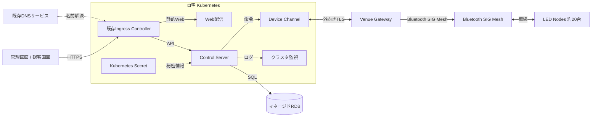
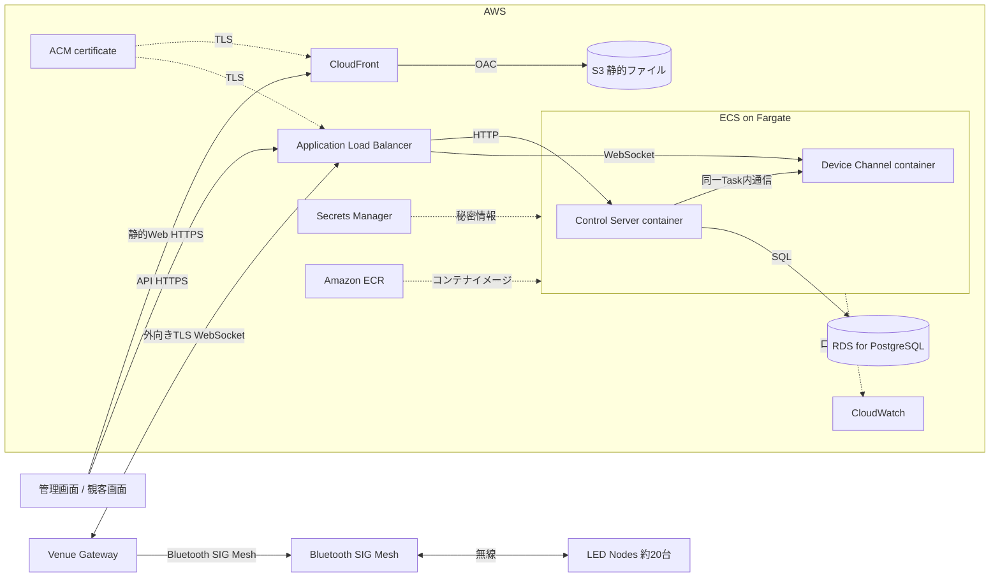

# 水上LED演出システム インフラ2案レビュー

## このIssueの目的

このIssueだけで、自宅Kubernetes案とAWSクラウド完結案を比較し、採用案または段階的な採用順序を決める。

詳細な経緯や仕様はnoteへ分けているが、レビューに必要な判断材料はこのIssue内に記載する。

## 共通前提

- 水上LED機器は約20台。
- 会場に、クラウドとBluetooth SIG Meshを橋渡しするVenue Gatewayを置く。
- Web ClientはLED機器へ直接接続せず、Control ServerとDevice Channelを経由する。
- Venue Gatewayはクラウドへ外向きにTLS接続する。クラウドから会場へ直接着信させない。
- 演出の細かな実行は会場側で行い、通信断時の継続可否は実装前検証で決める。
- 機器型番、SIG Meshのモデル、命令フォーマット、遅延目標はこのIssueでは固定しない。

## 提案1: 自宅Kubernetes基盤



### リソースと要点

| リソース | 役割 | 判断 |
|---|---|---|
| Kubernetes cluster | Web、Control Server、Device Channelを実行 | 既存設備を再利用する。ノード、電源、回線、ストレージは自分で運用 |
| Ingress Controller | HTTPS公開入口とルーティング | 既存のものを再利用。既存がNginxならNginx Ingressを使う |
| Web配信 | HTML、CSS、JavaScriptを配信 | 小規模ならKubernetes上でよい。CloudFrontは必須ではない |
| マネージドRDB | 状態、命令、履歴を保存 | DBまで自宅に置かず、バックアップ・復旧を外部へ分離する案を基本とする |
| Kubernetes Secret | DB接続情報、外部APIキーを保持 | Gitへ平文保存しない |
| 既存DNSサービス | ドメインをIngressへ向ける | サブドメインのCNAMEを設定する。Route 53は使わない |
| クラスタ監視 | API、接続、ノード状態を監視 | 実演時に外部からログを確認できるようにする |

### メリット・デメリット

| メリット | デメリット |
|---|---|
| 既存のKubernetes知識と設備を使える | 自宅の電源・回線・ノードが本番障害点になる |
| 初期のAWSリソースと固定費を抑えやすい | 公開入口、TLS、バックアップ、復旧を自分で運用する |
| 常時接続するDevice Channelを自由に動かせる | 観客数や会場数が増えたとき自宅回線が制約になる |

## 提案2: AWSクラウド完結



### リソースと要点

| リソース | 役割 | 判断 |
|---|---|---|
| S3 + CloudFront | 静的Webの保存・配信 | S3は非公開、CloudFront OACを使う。APIはキャッシュしない |
| Application Load Balancer | APIとDevice Channelの公開入口 | HTTPS APIとWebSocketをECSへ振り分ける |
| ECS on Fargate | Control ServerとDevice Channelを実行 | まず1 Service / 1 Task。Nginxは置かない |
| RDS for PostgreSQL | 状態、命令、履歴を保存 | 初期はRDBを単一の正とする |
| Secrets Manager | DB、Discord、ゲートウェイの秘密情報 | コンテナへ安全に注入する |
| ECR | コンテナイメージ保存 | CIからpushする |
| CloudWatch | ログ、メトリクス、アラーム | APIエラー、Task停止、ゲートウェイ切断を監視する |
| ACM | CloudFront / ALBのTLS | カスタムドメインを使う場合に利用 |
| 既存DNSサービス | DNS | サブドメインのCNAMEをCloudFrontまたはALBへ向ける。Route 53は使わない |

### メリット・デメリット

| メリット | デメリット |
|---|---|
| 自宅の電源・回線・ノードへ依存しない | ECS、ALB、VPC、RDS、IAM、監視を理解する必要がある |
| 公開入口と監視をAWSへ集約できる | 常時稼働リソースの固定費が発生する |
| 将来の複数会場へ拡張しやすい | Device Channelの再接続・ACK・重複排除は自前設計が必要 |

## 2案の比較

| 観点 | 自宅Kubernetes | AWSクラウド完結 |
|---|---|---|
| 初期費用 | 既存設備を使えば低い | AWSリソースの費用が発生 |
| 本番運用 | 自宅設備の復旧が必要 | AWSの監視・置換を利用しやすい |
| 公開入口 | Ingress、固定IP、DNS更新が論点 | ALB、ACM、VPCで構成 |
| 静的Web | Kubernetes上で配信 | S3 + CloudFront |
| 複数会場 | 自宅回線・クラスタの拡張が必要 | ECS、RDS、監視を拡張しやすい |
| 適する段階 | 開発、実験、低コスト運用 | 実演、本番、将来拡張 |

## 認証方式

| 対象 | 第一候補 | 代替候補 | 判断 |
|---|---|---|---|
| 管理者 | Discord OAuth2/OIDCをControl Serverが直接利用 | Cognito + Discord OIDC、メールOTP、Passkey | 少人数なら直接Discordが最も簡単。複数IdP、MFA、Passkeyが必要ならCognito |
| 観客 | イベント・会場限定の短期ゲストセッション | Discord、メールOTP | 観客にアカウント登録を要求しない。操作範囲とレート制限を設ける |
| Venue Gateway | ゲートウェイ単位の資格情報または証明書 | AWS IoT Core | 人間の認証とは分ける |

Discordを使う場合も、DiscordのGuild/Roleをそのままアプリケーション権限にしない。DiscordユーザーIDとアプリ内の管理者・演出担当権限を別に管理する。

## DNSとNginx

| 項目 | レビュー時の提案 |
|---|---|
| DNS | 既存DNSサービスでサブドメインのCNAMEを管理する。今回の提案ではRoute 53を使わない |
| AWS案のNginx | 原則使わない。ALBが公開入口、ASP.NET Core/KestrelがアプリのHTTPサーバーを担当する |
| 自宅Kubernetes案のNginx | 既存Ingress ControllerがNginxなら再利用する。アプリPod内へ別Nginxを追加しない |

## CloudFrontの利用体験と料金

- 利用者は通常のHTTPSサイトとしてアクセスする。キャッシュヒット時は近いエッジから静的ファイルが返る。
- JavaScriptやCSSはハッシュ付きファイル名、`index.html`は短いキャッシュまたは再検証とする。
- 従量課金では、月1TBのデータ転送、1,000万HTTP/HTTPSリクエスト、200万CloudFront Functions呼び出しが無料枠に含まれる。
- 2026-11-07時点の日本向け従量課金は、無料枠後の次の9TBが0.114 USD/GB、HTTPSリクエストが0.012 USD/10,000リクエスト。最初の1,000 invalidation pathsは無料。
- 定額プランもあるが、初期の小規模運用では従量課金を基本にし、WAF・ログ・DNSを含めた予算管理が必要になったら比較する。
- S3、ECS、RDS、ALB、NAT Gateway、利用中DNSサービスの料金は別に発生する。

## レビューで決めること

- 実演時の本番基盤として、自宅の電源・回線・ノード障害を許容するか。
- 自宅Kubernetes案を採用する場合、既存Ingress、外部公開経路、DNS更新、監視を再利用できるか。
- AWSクラウド完結案の常時稼働費用と運用負担を許容できるか。
- 利用中のDNSサービスでサブドメインのCNAMEを管理できるか。
- Nginxを追加する明確な理由があるか。
- 管理者をDiscord利用者に限定してよいか。
- 観客を短期ゲストセッションで扱ってよいか。
- 通信断中も会場側で演出を継続するか。

## コメントの書き方

```text
対象: 自宅Kubernetes案 / AWSクラウド完結案 / 共通
論点: リソース名または要件
判断: 採用 / 修正 / 保留
理由: 運用条件、費用、利用体験、将来拡張など
```

## 完了条件

- 採用する案、または段階的な採用順序が決まる。
- Route 53を使わず、Nginxを追加しない判断が決まる。
- 管理者・観客・Venue Gatewayの認証境界が決まる。
- 未決定事項が、実装前検証と別の設計課題に分離される。

## 詳細note

- [背景・スコープ](https://github.com/AobaIwaki123/water-led-infrastructure-proposal/blob/main/notes/00-background-and-scope.md)
- [論理アーキテクチャ](https://github.com/AobaIwaki123/water-led-infrastructure-proposal/blob/main/notes/01-logical-architecture.md)
- [実行基盤・リソース](https://github.com/AobaIwaki123/water-led-infrastructure-proposal/blob/main/notes/02-platform-and-resources.md)
- [公開入口・静的Web・DNS](https://github.com/AobaIwaki123/water-led-infrastructure-proposal/blob/main/notes/03-public-entry-and-static-web.md)
- [認証方式](https://github.com/AobaIwaki123/water-led-infrastructure-proposal/blob/main/notes/04-authentication.md)
- [状態・秘密情報・監視](https://github.com/AobaIwaki123/water-led-infrastructure-proposal/blob/main/notes/05-state-secrets-observability.md)
- [実装前検証](https://github.com/AobaIwaki123/water-led-infrastructure-proposal/blob/main/notes/06-validation.md)

## 公式資料

- [CloudFront pay-as-you-go pricing](https://aws.amazon.com/cloudfront/pricing/pay-as-you-go/)
- [CloudFront flat-rate pricing plans](https://docs.aws.amazon.com/AmazonCloudFront/latest/DeveloperGuide/flat-rate-pricing-plan.html)
- [Discord OAuth2](https://docs.discord.com/developers/topics/oauth2)
- [Amazon Cognito User Pools](https://docs.aws.amazon.com/cognito/latest/developerguide/cognito-user-pools.html)
