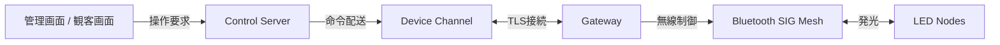

# Note 00: 背景・スコープ・用語

## 背景

約20台の水上LED機器を、管理画面や観客画面から操作する。会場ではBluetooth SIG Meshを使う予定だが、クラウドと無線メッシュの間にはGatewayを置く。

検討当初は、自宅Kubernetes、EC2、ECS、IoT Core、Lambda、RDB、DynamoDB KVSを個別に比較していた。レビュー対象が増えすぎるため、最終提案は自宅Kubernetes基盤とAWSクラウド完結の2案へ絞った。

## スコープ

この資料群で扱うのは、次の境界である。

## 用語

| 用語 | 意味 |
|---|---|
| Control Server | API、認証、権限、演出状態を扱うクラウドまたはKubernetes上のアプリ |
| Device Channel | Control ServerとGatewayの論理通信層 |
| Gateway | クラウド接続とBluetooth SIG Meshを橋渡しする会場側機器 |
| RDB | 演出、命令、履歴、利用者対応表を保存するリレーショナルデータベース |

## 決めないこと

機器型番、SIG Meshのモデル、命令フォーマット、観客操作の競合ルール、必要遅延、通信断時の厳密な演出継続方法は実装前検証で決める。
