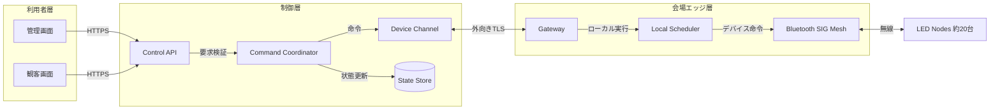

# Note 01: 論理アーキテクチャ

## 共通構造

2案とも、利用者、制御アプリ、会場ゲートウェイ、水上デバイスの責務を分離する。

## 責務の境界

- Control Serverは利用者、会場、操作内容を検証する。
- Device Channelはゲートウェイとの接続、接続状態、命令配送を扱う。
- Gatewayはクラウド側の命令を現地のSIG Meshへ変換する。
- Local Schedulerは、必要な演出を現地で継続する。
- LED NodeはクラウドAPIを直接公開しない。

## 通信断の考え方

ゲートウェイがすでに受信した演出を通信断中も続けるかは未確定だが、インターネット経由の都度制御だけに依存しない構成を候補とする。再接続後は、ゲートウェイが現在状態と最後に処理した世代を報告できる設計を検証する。
