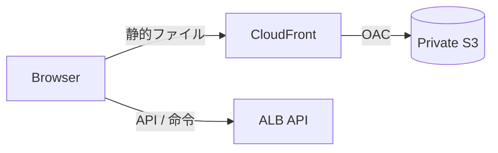

# Note 03: 公開入口・静的Web・DNS

## CloudFrontの役割

CloudFrontはクラウド完結案の静的Web配信に限定する。S3バケットは非公開にし、CloudFrontのOrigin Access Controlからだけ読めるようにする。APIの命令・状態レスポンスはキャッシュしない。

利用者からは通常のHTTPSサイトに見える。キャッシュヒット時はエッジから返り、キャッシュミス時にS3へ取りに行く。JavaScriptやCSSはハッシュ付きファイル名、`index.html`は短いキャッシュまたは再検証にする。

## DNSの判断

今回の提案ではRoute 53を使わない。利用中のDNSサービスでサブドメインのCNAMEを管理し、CloudFrontまたはALBへ向ける。

| 状況 | 判断 |
|---|---|
| 自宅Kubernetes案 | 既存DNSサービスのCNAMEをIngressへ向ける |
| AWSクラウド完結案 | 既存DNSサービスのCNAMEをCloudFrontまたはALBへ向ける |
| 将来ルートドメインを使う | DNS事業者のALIAS/ANAMEが必要になった場合だけ再検討する |

## Nginx

- AWS案ではALB + Kestrelを基本とし、Nginxを置かない。
- 自宅Kubernetes案では、既存Ingress ControllerがNginxならそれを使う。
- アプリPod内にNginxを追加するのは、特別なリバースプロキシ制御や既存運用標準が必要な場合だけにする。

## TLS

- AWS案: ACM証明書をCloudFrontとALBへ関連付ける。
- 自宅Kubernetes案: 既存Ingressの証明書管理方法を利用する。

## 参考

- [CloudFrontの動作](https://docs.aws.amazon.com/AmazonCloudFront/latest/DeveloperGuide/HowCloudFrontWorks.html)
- [S3 Origin Access Control](https://docs.aws.amazon.com/AmazonCloudFront/latest/DeveloperGuide/private-content-restricting-access-to-s3.html)
- [CloudFrontのカスタムドメイン](https://docs.aws.amazon.com/AmazonCloudFront/latest/DeveloperGuide/CNAMEs.html)
