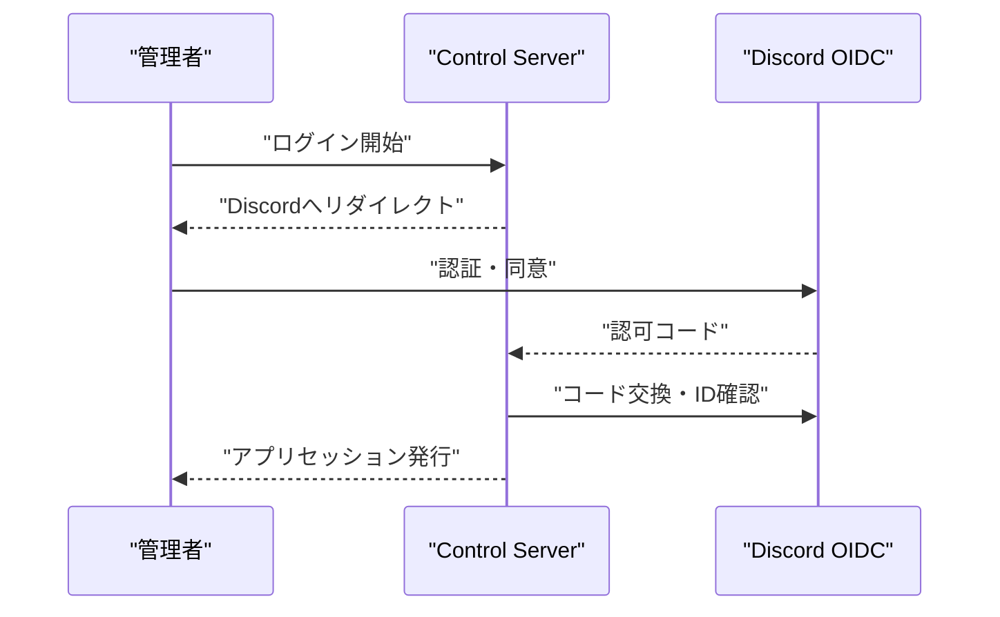

# Note 04: 認証方式

## 人間と機器を分ける

管理者、観客、Venue Gatewayは、必要な本人確認と権限が異なる。人間向けのログイン方式をゲートウェイ認証へ流用しない。

## 管理者

### Discord OAuth2/OIDCを直接利用

少人数の管理者がDiscordを利用しているなら、Control ServerがDiscordの認可コードフローを直接利用する構成が最も短い。アプリ側では認可コード、`state`、issuer、IDトークンの署名・有効期限、セッションを検証する。

DiscordのユーザーIDとアプリケーション内の管理者・演出担当権限は別に管理する。Guild/Roleをそのままアプリ権限にしない。

### Cognitoを前段に置く

複数IdP、MFA、Passkey、組織向けSSO、複数アプリケーションの共通認証が必要なら、Cognito User PoolをアプリのOIDC発行者にし、Discordを外部OIDC IdPとして接続する。構成と設定は増えるが、アプリ側のトークン形式を統一しやすい。

## 観客

観客にはイベント・会場に限定した短期ゲストセッションを発行する。セッションには対象イベント、会場、操作範囲、有効期限を含め、Control Serverでレート制限する。本人識別や操作監査が必要になったら、DiscordまたはメールOTPを再評価する。

## Venue Gateway

ゲートウェイ単位の資格情報または証明書で認証する。ゲートウェイが外向きにTLS接続し、接続後のメッセージにgatewayIdと命令識別子を持たせる。

## 参考

- [Discord OAuth2](https://docs.discord.com/developers/topics/oauth2)
- [Discord OpenID Connect discovery](https://discord.com/.well-known/openid-configuration)
- [Amazon Cognito User Pools](https://docs.aws.amazon.com/cognito/latest/developerguide/cognito-user-pools.html)
- [Amazon CognitoのOIDC IdP連携](https://docs.aws.amazon.com/cognito/latest/developerguide/cognito-user-pools-oidc-idp.html)
